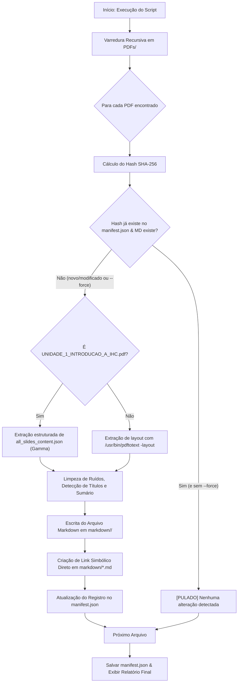

# Acervo Digital de Materiais de IHC — UFABC

> **Disciplina:** MCZA008-17 — Interação Humano-Computador  
> **Instituição:** Universidade Federal do ABC (UFABC)  
> **Docente Responsável:** Profª Drª Juliana Cristina Braga  
> **Compilação e Curadoria Técnica:** Subagente Especialista em IHC & Engenharia de Software (Flash / Argon 4 Max)  

Este diretório centraliza os materiais instrucionais, slides de aulas presenciais, guias metodológicos e atividades práticas da disciplina de Interação Humano-Computador (IHC), complementados por um pipeline automatizado de conversão incremental para **Markdown semântico e estruturado**.

---

## 1. Estrutura Organizacional do Repositório

```text
PDFs/
├── README.md                      # Documentação completa do acervo e do compilador
├── manifest.json                  # Manifesto incremental com hashes SHA-256 e status
│
├── Slides/                        # Apresentações de slides das aulas teóricas e práticas
│   ├── Slide 01.pdf               # Unidade 1: Fundamentos de IHC
│   ├── Slide 01.url               # Link para a apresentação interativa no Gamma
│   ├── Slide 02.pdf               # Unidade 2: Design Ético e Padrões Obscuros
│   ├── Slide 02.url               # Link de apoio no Google Drive
│   ├── Slide 03.pdf               # Unidade 3A: Levantamento de Requisitos (UBS Jardim Esperança)
│   ├── Slide 03.url               # Link de apoio no Google Drive
│   ├── Slide 04.pdf               # Unidade 4: Comparativo de Ferramentas de Prototipação
│   ├── Slide 04.url               # Link para o carrossel Moodle UFABC
│   ├── Slide 05.pdf               # Unidade 5: Acessibilidade e Desenho Universal
│   ├── Slide 05.url               # Link de apoio no Google Drive
│   └── UNIDADE_1_INTRODUCAO_A_IHC.pdf # Versão PDF dos slides da Unidade 1
│
├── Guia/                          # Guias metodológicos institucionais e estudos de caso
│   ├── Documento de Requisitos.pdf # Guia para Planejamento e Especificação de Requisitos
│   ├── Documento de Requisitos.url # Link para o carrossel no Moodle UFABC
│   ├── Estudo de Caso.pdf         # Caso prático: Jogo Expedição Antártica (Design Participativo)
│   ├── Estudo de Caso.url         # Link de apoio no Google Drive
│   ├── Uso de IA.pdf              # Guia Institucional de Uso Ético e Crítico da IAG (INTERA UFABC)
│   └── Uso de IA.url              # Link de apoio no Google Drive
│
├── Atividades/                    # Atividades práticas, roteiros de avaliação e canvas
│   ├── Atividade_1_Auditoria_IHC_Grupo.pdf # Prática 1: Auditoria Heurística em Apps (Grupo)
│   ├── Canvas_Etapa_1_-_IHC.pptx.pdf       # Canvas de Gestão do Projeto em 13 Blocos (Etapa 1)
│   └── atv1.1_IHC.pdf                      # Avaliação Prática Individual (Estudo de Caso Duolingo)
│
└── markdown/                      # Arquivos Markdown gerados automaticamente pelo compilador
    ├── Slides/                    # Markdown hierárquico dos slides
    ├── Guia/                      # Markdown hierárquico dos guias
    ├── Atividades/                # Markdown hierárquico das atividades
    └── *.md                       # Links simbólicos diretos (acesso facilitado)
```

---

## 2. Catálogo do Acervo e Mapeamento de Conteúdo

| Arquivo PDF Original | Categoria | Páginas / Slides | Markdown Compilado | Tópicos Centrais Abordados |
| :--- | :---: | :---: | :--- | :--- |
| [`Slide 01.pdf`](file:///home/felipe/Documents/IHC/PDFs/Slides/Slide%2001.pdf) | Slides | 26 slides | [`Slide 01.md`](file:///home/felipe/Documents/IHC/PDFs/markdown/Slides/Slide%2001.md) | Fundamentos de IHC; Evolução das Interfaces (CLI → GUI → Web → Mobile → IA); Design Centrado no Usuário vs. Tecnologia; Interface, Interação, Affordance, Usabilidade, UX, Acessibilidade e Comunicabilidade. |
| [`Slide 02.pdf`](file:///home/felipe/Documents/IHC/PDFs/Slides/Slide%2002.pdf) | Slides | 74 slides | [`Slide 02.md`](file:///home/felipe/Documents/IHC/PDFs/markdown/Slides/Slide%2002.md) | Design Ético (Profª Juliana Braga); Paradigmas Éticos (Deontologia, Consequencialismo, Ética das Virtudes); Dark Patterns (Confirmshaming, Roach Motel, Misdirection, etc.); Enquadramento Legal e LGPD. |
| [`Slide 03.pdf`](file:///home/felipe/Documents/IHC/PDFs/Slides/Slide%2003.pdf) | Slides | 165 slides | [`Slide 03.md`](file:///home/felipe/Documents/IHC/PDFs/markdown/Slides/Slide%2003.md) | Aula 3A: Fundamentos e o Usuário; Levantamento de Requisitos com Usuários; Estudo de Caso real na UBS Jardim Esperança; Stakeholders Diretos e Indiretos; Técnicas de Coleta (Entrevistas, Observação, Questionários). |
| [`Slide 04.pdf`](file:///home/felipe/Documents/IHC/PDFs/Slides/Slide%2004.pdf) | Slides | 15 slides | [`Slide 04.md`](file:///home/felipe/Documents/IHC/PDFs/markdown/Slides/Slide%2004.md) | Ferramentas de Prototipação; Baixa, Média e Alta Fidelidade; Tabela Comparativa detalhada (Figma, Penpot, Marvel, Balsamiq, Miro); Roteiro para escolha orientada às fases do projeto. |
| [`Slide 05.pdf`](file:///home/felipe/Documents/IHC/PDFs/Slides/Slide%2005.pdf) | Slides | 36 slides | [`Slide 05.md`](file:///home/felipe/Documents/IHC/PDFs/markdown/Slides/Slide%2005.md) | Acessibilidade e Desenho Universal no Desenvolvimento de Sistemas (Profª Juliana Braga); Tecnologias Assistivas; Os 7 Princípios do Desenho Universal; Diretrizes WCAG 2.1 AA e eMAG; Avaliação com leitores de tela. |
| [`UNIDADE_1_INTRODUCAO_A_IHC.pdf`](file:///home/felipe/Documents/IHC/PDFs/Slides/UNIDADE_1_INTRODUCAO_A_IHC.pdf) | Slides | 26 slides | [`UNIDADE_1_INTRODUCAO_A_IHC.md`](file:///home/felipe/Documents/IHC/PDFs/markdown/Slides/UNIDADE_1_INTRODUCAO_A_IHC.md) | Apresentação Gamma completa da Unidade 1, integrada a partir do extrator semântico (`all_slides_content.json`); Roteiro didático de 120 min; Exemplos visuais enriquecidos de validação e feedback de erros. |
| [`Documento de Requisitos.pdf`](file:///home/felipe/Documents/IHC/PDFs/Guia/Documento%20de%20Requisitos.pdf) | Guia | 11 slides | [`Documento de Requisitos.md`](file:///home/felipe/Documents/IHC/PDFs/markdown/Guia/Documento%20de%20Requisitos.md) | Guia oficial para elaboração do Documento de Requisitos em duas etapas estruturadas: (1) Planejamento da pesquisa com usuários e (2) Especificação formal dos requisitos a partir das evidências empíricas. |
| [`Estudo de Caso.pdf`](file:///home/felipe/Documents/IHC/PDFs/Guia/Estudo%20de%20Caso.pdf) | Guia | 47 slides | [`Estudo de Caso.md`](file:///home/felipe/Documents/IHC/PDFs/markdown/Guia/Estudo%20de%20Caso.md) | Design Universal na Prática: O jogo Expedição Antártica; Dissertação de Francinete Furtado da Cunha orientada por Juliana Braga e Kate Kumada (UFABC/CAPES); Construção participativa de diretrizes de acessibilidade. |
| [`Uso de IA.pdf`](file:///home/felipe/Documents/IHC/PDFs/Guia/Uso%20de%20IA.pdf) | Guia | 10 páginas | [`Uso de IA.md`](file:///home/felipe/Documents/IHC/PDFs/markdown/Guia/Uso%20de%20IA.md) | Guia de Uso Ético e Crítico da Inteligência Artificial Generativa (IAG); Autoria: Juliana Braga, Silvia Dotta, Edson Pimentel (Grupo de Pesquisa INTERA UFABC); Diretrizes de transparência, verificação de alucinações e autoria. |
| [`Atividade_1_Auditoria_IHC_Grupo.pdf`](file:///home/felipe/Documents/IHC/PDFs/Atividades/Atividade_1_Auditoria_IHC_Grupo.pdf) | Atividades | 9 páginas | [`Atividade_1_Auditoria_IHC_Grupo.md`](file:///home/felipe/Documents/IHC/PDFs/markdown/Atividades/Atividade_1_Auditoria_IHC_Grupo.md) | Prática 1: Relatório de Auditoria de IHC em Aplicativos e Compartilhamento de Descobertas; Análise heurística em grupo (WhatsApp, Itaú, iFood, Spotify, Duolingo, Instagram); 10 Heurísticas de Nielsen. |
| [`Canvas_Etapa_1_-_IHC.pptx.pdf`](file:///home/felipe/Documents/IHC/PDFs/Atividades/Canvas_Etapa_1_-_IHC.pptx.pdf) | Atividades | 8 slides | [`Canvas_Etapa_1_-_IHC.pptx.md`](file:///home/felipe/Documents/IHC/PDFs/markdown/Atividades/Canvas_Etapa_1_-_IHC.pptx.md) | Modelo oficial do Canvas de Gestão do Projeto em uma página (13 blocos fundamentais: Justificativas, Produto, Stakeholders Externos, Premissas, Riscos, etc.). |
| [`atv1.1_IHC.pdf`](file:///home/felipe/Documents/IHC/PDFs/Atividades/atv1.1_IHC.pdf) | Atividades | 1 página | [`atv1.1_IHC.md`](file:///home/felipe/Documents/IHC/PDFs/markdown/Atividades/atv1.1_IHC.md) | Atividade Prática Individual 1.1: Escolha e justificativa do aplicativo Duolingo sob a ótica do Design Centrado no Usuário, gamificação, microlearning e redução de sobrecarga cognitiva. |

---

## 3. Arquitetura da Compilação Incremental (`compilar_materiais.py`)

A compilação automatizada é orquestrada pelo script [`compilar_materiais.py`](file:///home/felipe/Documents/IHC/compilar_materiais.py), desenvolvido para garantir alta performance, rastreabilidade e idempotência.



### Principais Funcionalidades do Compilador:

1. **Compilação Incremental por Hashing Criptográfico (SHA-256):**
   - O arquivo [`manifest.json`](file:///home/felipe/Documents/IHC/PDFs/manifest.json) armazena o checksum SHA-256, tamanho em bytes, quantidade de páginas/slides, carimbo de data/hora (ISO-8601 UTC) e caminho de saída.
   - Caso um PDF não tenha sido alterado e o arquivo Markdown correspondente exista íntegro no disco, a compilação é imediatamente pulada, economizando ciclos de processamento e evitando retrabalho.

2. **Extração de Alta Fidelidade Semântica & Correção Fonética de OCR:**
   - Para os PDFs convencionais, utiliza o binário do sistema `/usr/bin/pdftotext -layout`, preservando colunas, tabelas, recuos e diagramações originais.
   - Aplica filtros inteligentes de pós-processamento para remover artefatos de carrossel web (ex.: instruções de navegação por teclado como `"as do teclado"`, `"ou os botões"` e marcas de carrossel).
   - Corrige ativamente falhas de codificação de fontes do PDF original (ex.: restaura caracteres suprimidos como `'s'`, `'n'`, `'m'`, `'h'` no `Uso de IA.pdf` e desfragmenta palavras com letras separadas por espaços nos slides).
   - Identifica os títulos reais de cada seção ou slide, gerando um cabeçalho Markdown padronizado (`## Slide X: ...` ou `## Página X: ...`) e um **Sumário clicável com âncoras internas** sem truncamentos.

3. **Injeção de Conteúdo para Slides de Imagem & Tratamento Gamma:**
   - O arquivo `UNIDADE_1_INTRODUCAO_A_IHC.pdf` consiste em capturas visuais sem camada nativa de texto, sendo tratado diretamente pelo extrator semântico JSON em [`all_slides_content.json`](file:///home/felipe/Documents/IHC/all_slides_content.json).
   - Slides puramente ilustrativos ou que contêm diagramas e interfaces sem texto nativo (como os comparativos de *Roach Motel* no Slide 02 e as tecnologias assistivas no Slide 05) recebem transcrições e análises pedagógicas estruturadas via injeção de conteúdo contextual.

4. **Síntese de Diretrizes Práticas de IHC para o Projeto (Padrão Ouro & AGENTS.md):**
   - Cada documento compilado inclui, ao seu término, uma seção prática destacada com os aprendizados, heurísticas e diretrizes aplicáveis diretamente ao desenvolvimento da Central OBI UFABC, servindo como base teórica rápida para consulta por desenvolvedores e agentes autônomos.

5. **Dupla Acessibilidade no Diretório Markdown:**
   - Os arquivos são salvos preservando a taxonomia (`markdown/Slides/`, `markdown/Guia/`, `markdown/Atividades/`).
   - Simultaneamente, são gerados links simbólicos no nível raiz de `markdown/`, permitindo que scripts ou visualizadores acessem arquivos tanto por caminho absoluto categorizado quanto por nome de arquivo plano (`Slide 01.md`).

---

## 4. Instruções de Execução do Script

O script pode ser executado diretamente no terminal via Python 3:

```bash
# Execução incremental padrão (apenas compila arquivos novos ou modificados):
python3 /home/felipe/Documents/IHC/compilar_materiais.py

# Execução detalhada (exibe os arquivos pulados e detalhes do hash):
python3 /home/felipe/Documents/IHC/compilar_materiais.py --verbose

# Forçar a recompilação de TODOS os PDFs (ignora o cache do manifesto):
python3 /home/felipe/Documents/IHC/compilar_materiais.py --force

# Compilar apenas um arquivo específico:
python3 /home/felipe/Documents/IHC/compilar_materiais.py --file "Slide 02"
```

---

## 5. Auditoria de Conformidade e Acessibilidade

Os arquivos Markdown gerados foram projetados seguindo as melhores práticas de **Acessibilidade e IHC (WCAG 2.1 AA / eMAG)**:
- **Hierarquia de Títulos Rigorosa:** H1 único por documento, seguido estritamente por H2 para cada slide/página.
- **Navegação Clicável:** Todos os sumários possuem âncoras explícitas para navegação rápida por leitores de tela e atalhos de teclado.
- **Metadados Transparentes:** Cada documento traz expressamente o arquivo original de origem, o tipo de mídia, o hash SHA-256 para auditoria de integridade e a data/hora de geração.
