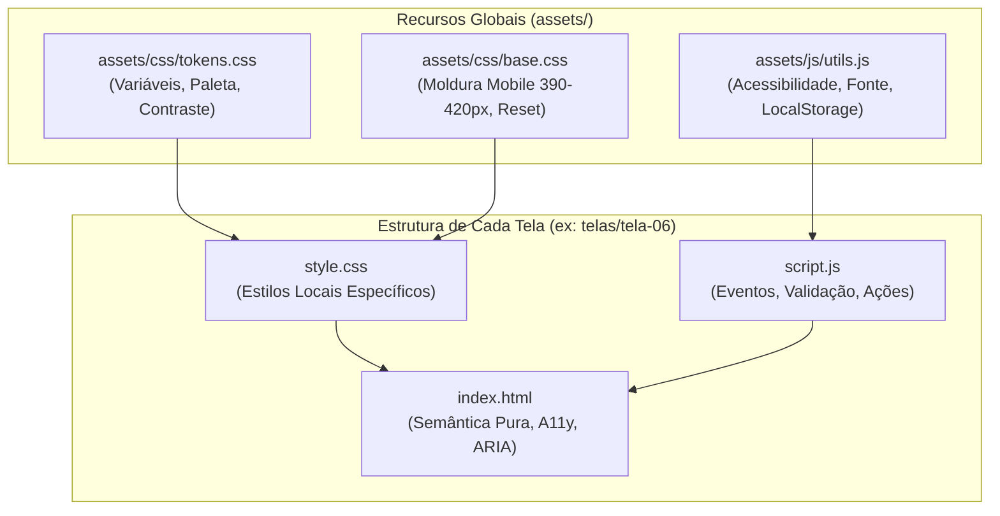

# Central OBI UFABC · Protótipo Interativo de IHC
> **Aplicação Web Mobile-First desenvolvida para a disciplina de Interação Humano-Computador (UFABC 2026.3)**  
> **Docente:** Profª. Dra. Juliana Braga | **Centro:** CMCC / UFABC  
> **Padrão Normativo:** WCAG 2.1 Nível AA · Design Ético · Arquitetura Tripartite Desacoplada

**Acesse o aplicativo em produção:** [https://obiwebapp.vercel.app](https://obiwebapp.vercel.app) | [Espelho GitHub Pages](https://gabrielfrigo4.github.io/obi-website/)

---

## 🎯 1. Visão Geral e Propósito Social

A **Central OBI UFABC** é uma aplicação web concebida para democratizar e desmistificar o ingresso de estudantes da educação básica — com especial prioridade para alunos de escolas públicas da região do Grande ABC paulista — na **Olimpíada Brasileira de Informática (OBI)**.

Historicamente, competições acadêmicas de informática impõem barreiras cognitivas e burocráticas severas: editais herméticos de dezenas de páginas, terminologia técnica excludente, cadastros obrigatórios complexos e ausência de apoio para estudantes cujas escolas não possuem docentes credenciados. 

Este protótipo resolve esse abismo por meio de:
- **Diagnóstico Acolhedor de Nível (Telas 06 a 08)**: Questionário em linguagem natural e direta, sem termos computacionais intimidadores, orientando o aluno entre desafios no papel (Iniciação) ou no computador (Programação).
- **Garantia de Polo Universitário (Telas 09 a 11)**: Se a escola pública do estudante não participa ou não tem professor cadastrado, a UFABC intervém como Polo Regional acolhedor, emitindo comprovante de solicitação com protocolo formal.
- **Rede Comunitária e Extensão Contínua (Tela 12)**: Acesso direto a grupo oficial no WhatsApp moderado por docentes e monitores da UFABC, cadernos oficiais de treino da UNICAMP e FAQ acessível.

---

## 🏛️ 2. A Arquitetura Tripartite e o "Padrão Ouro"

Para assegurar manutenibilidade exemplar, código limpo e auditabilidade por qualquer avaliador docente ou estudante sem necessidade de ferramentas de compilação (*build tools*), todo o projeto obedece ao **Padrão Ouro**, definido no módulo de referência [`telas/template-base/`](./telas/template-base/).

### 2.1. Princípio da Separação Tripartite Estrita
Cada tela ou módulo do sistema é isolado em seu próprio diretório, estruturado estritamente em três arquivos com responsabilidades únicas:

```
telas/modulo-exemplo/
├── index.html   # 1. Marcação semântica pura (Zero tags <style> ou <script> inline)
├── style.css    # 2. Estilização modular e contextual (Consome tokens compartilhados)
└── script.js    # 3. Lógica comportamental pura (Eventos desacoplados em DOMContentLoaded)
```

1. **HTML5 Semântico (`index.html`)**:
   - Proibido qualquer bloco `<style>` embutido ou atributo `style="..."` inline.
   - Proibido qualquer código JavaScript inline (como `onclick=""` ou `<script>` embutido).
   - Uso de elementos semânticos nativos: `<header>`, `<nav>`, `<main>`, `<section>`, `<fieldset>`, `<legend>`, `<details>`, `<summary>`.
   - Um único `<h1>` por tela, estabelecendo a hierarquia semântica para tecnologias assistivas.
2. **Estilização Modular e Contextual (`style.css`)**:
   - Importa e consome os Design Tokens centrais definidos em [`assets/css/tokens.css`](./assets/css/tokens.css) e a moldura mobile-first de [`assets/css/base.css`](./assets/css/base.css).
   - Contém apenas regras de layout específicas daquela tela (espaçamentos contextuais, estados dinâmicos e regras de impressão `@media print`).
3. **Comportamento e Lógica Pura (`script.js`)**:
   - Inicialização estrita através do evento `DOMContentLoaded`.
   - Funções nomeadas com nomenclatura clara e em português (ex.: `restaurarRespostaSalva()`, `validarFormulario()`, `copiarProtocolo()`).
   - Comunicação via persistência ética local em `localStorage` através dos utilitários compartilhados de [`assets/js/utils.js`](./assets/js/utils.js).



---

## 📱 3. Catálogo Detalhado de Telas e Módulos

O ponto de entrada geral da aplicação é o [**Hub de Protótipos (`index.html`)**](./index.html), que permite testar toda a navegação encadeada ou saltar para qualquer tela isoladamente:

| Identificador | Título & Escopo | Arquivo HTML | Folha de Estilo | Lógica JavaScript | Status |
| :--- | :--- | :--- | :--- | :--- | :--- |
| **Hub** | **Painel Central de Navegação e Apresentação**<br>Visão panorâmica de todas as telas, alternador global de acessibilidade e banner de início rápido. | [`index.html`](./index.html) | [`assets/css/hub.css`](./assets/css/hub.css) | [`assets/js/hub.js`](./assets/js/hub.js) | <span style="color:#047857;font-weight:bold;">100% Funcional</span> |
| **Template Base** | **Padrão Ouro de Referência**<br>Molde canônico para criação de novas telas com barra acessível, progresso, fieldset e botões de ação. | [`index.html`](./telas/template-base/index.html) | [`style.css`](./telas/template-base/style.css) | [`script.js`](./telas/template-base/script.js) | <span style="color:#047857;font-weight:bold;">100% Funcional</span> |
| **Tela 01** | **Início / Painel da Jornada OBI**<br>Interface principal mobile-first com situação da próxima prova e atalhos rápidos para todos os módulos. | [`index.html`](./telas/tela-01-home/index.html) | [`style.css`](./telas/tela-01-home/style.css) | [`script.js`](./telas/tela-01-home/script.js) | <span style="color:#047857;font-weight:bold;">100% Funcional</span> |
| **Tela 02** | **Calendário Oficial & Prazos Acessíveis**<br>Linha do tempo oficial com alternância Iniciação/Programação, lembretes locais e download de arquivo `.ics`. | [`index.html`](./telas/tela-02-calendario/index.html) | [`style.css`](./telas/tela-02-calendario/style.css) | [`script.js`](./telas/tela-02-calendario/script.js) | <span style="color:#047857;font-weight:bold;">100% Funcional</span> |
| **Tela 03** | **Trilha de Estudos & Checklist Interativo**<br>Checklist interativo por categorias (Iniciação, Prog. Jr, Nível 1/2, Sênior), progresso local e links de prática. | [`index.html`](./telas/tela-03-checklist/index.html) | [`style.css`](./telas/tela-03-checklist/style.css) | [`script.js`](./telas/tela-03-checklist/script.js) | <span style="color:#047857;font-weight:bold;">100% Funcional</span> |
| **Tela 04** | **Editais Descomplicados em Linguagem Simples**<br>Regras oficiais da OBI sem termos jurídicos herméticos, materiais permitidos e linguagens de programação. | [`index.html`](./telas/tela-04-editais/index.html) | [`style.css`](./telas/tela-04-editais/style.css) | [`script.js`](./telas/tela-04-editais/script.js) | <span style="color:#047857;font-weight:bold;">100% Funcional</span> |
| **Tela 05** | **Kit do Monitor / Professor Voluntário**<br>Modelos de mensagens prontas para compartilhamento em WhatsApp com cópia rápida e validação de data. | [`index.html`](./telas/tela-05-kit-monitor/index.html) | [`style.css`](./telas/tela-05-kit-monitor/style.css) | [`script.js`](./telas/tela-05-kit-monitor/script.js) | <span style="color:#047857;font-weight:bold;">100% Funcional</span> |
| **Tela 06** | **Quiz: Pergunta 1 — Ano Escolar**<br>Início da jornada diagnóstica (Barra em 33%). Identifica Fundamental I, II, Médio ou Superior. | [`index.html`](./telas/tela-06-quiz-pergunta-1/index.html) | [`style.css`](./telas/tela-06-quiz-pergunta-1/style.css) | [`script.js`](./telas/tela-06-quiz-pergunta-1/script.js) | <span style="color:#047857;font-weight:bold;">100% Funcional</span> |
| **Tela 07** | **Quiz: Pergunta 2 — Preferência de Desafios**<br>Identificação de afinidade (Barra em 66%). Escolha acolhedora entre raciocínio lógico no papel ou código no computador. | [`index.html`](./telas/tela-07-quiz-logica/index.html) | [`style.css`](./telas/tela-07-quiz-logica/style.css) | [`script.js`](./telas/tela-07-quiz-logica/script.js) | <span style="color:#047857;font-weight:bold;">100% Funcional</span> |
| **Tela 08** | **Quiz: Pergunta 3 — Série & Apoio Escolar**<br>Mapeamento de suporte docente (Barra em 100%). Detecta se a escola já tem professor ou se o aluno precisará de polo. | [`index.html`](./telas/tela-08-quiz-apoio/index.html) | [`style.css`](./telas/tela-08-quiz-apoio/style.css) | [`script.js`](./telas/tela-08-quiz-apoio/script.js) | <span style="color:#047857;font-weight:bold;">100% Funcional</span> |
| **Tela 09** | **Resultado do Diagnóstico & Categoria OBI**<br>Exibição dinâmica da categoria recomendada (Iniciação 1/2 ou Programação Jr/1/2/Sr), tópicos de estudo e botão para solicitar apoio. | [`index.html`](./telas/tela-09-resultado-nivel/index.html) | [`style.css`](./telas/tela-09-resultado-nivel/style.css) | [`script.js`](./telas/tela-09-resultado-nivel/script.js) | <span style="color:#047857;font-weight:bold;">100% Funcional</span> |
| **Tela 10** | **Solicitação de Apoio para Escola Pública**<br>Formulário simples e ético para inclusão da escola pelo projeto de extensão universitária da UFABC. | [`index.html`](./telas/tela-10-solicitacao-escola/index.html) | [`style.css`](./telas/tela-10-solicitacao-escola/style.css) | [`script.js`](./telas/tela-10-solicitacao-escola/script.js) | <span style="color:#047857;font-weight:bold;">100% Funcional</span> |
| **Tela 11** | **Confirmação de Solicitação & Polo UFABC**<br>Comprovante formal com código de protocolo dinâmico, resumo cadastral, botão de cópia, impressão limpa e garantia de vaga. | [`index.html`](./telas/tela-11-confirmacao-polo/index.html) | [`style.css`](./telas/tela-11-confirmacao-polo/style.css) | [`script.js`](./telas/tela-11-confirmacao-polo/script.js) | <span style="color:#047857;font-weight:bold;">100% Funcional</span> |
| **Tela 12** | **Hub Comunitário & Extensão UFABC**<br>Central de integração com botão do grupo WhatsApp da UFABC, links diretos de treino oficial da UNICAMP e FAQ expansível. | [`index.html`](./telas/tela-12-comunidade-extensao/index.html) | [`style.css`](./telas/tela-12-comunidade-extensao/style.css) | [`script.js`](./telas/tela-12-comunidade-extensao/script.js) | <span style="color:#047857;font-weight:bold;">100% Funcional</span> |

---

## 🔬 4. Fundamentação Teórica em IHC

Todas as soluções de layout, interação e fluxo foram projetadas com embasamento nas literaturas e normas de IHC estudadas na UFABC:

### 4.1. As 10 Heurísticas de Usabilidade de Jakob Nielsen

1. **Visibilidade do Estado do Sistema (#1)**:
   - A barra de progresso visual e semântica (`aria-label="Progresso da Etapa"` com `role="progressbar"`) informa exatamente a etapa do quiz (33%, 66%, 100%).
   - Confirmações de ações (como "✓ Mensagem copiada!" e feedback de protocolo) comunicam imediatamente a alteração de estado.
2. **Correspondência entre o Sistema e o Mundo Real (#2)**:
   - Abandono de nomenclaturas áridas como "Subnível 1 da Fase Seletiva". Em seu lugar: *"Problemas lógicos e enigmas no papel"* e *"Começar a programar no computador"*.
   - Uso de termos familiares à rotina escolar pública brasileira (6º ao 9º ano, Ensino Médio, Polo de Apoio).
3. **Controle e Liberdade do Usuário (#3)**:
   - Botão de retorno padronizado (`← Voltar`) presente no cabeçalho de todas as telas, permitindo ao aluno refazer escolhas sem reiniciar do zero.
   - Liberdade para escolher qualquer opção sem travamento de página ou menus modais bloqueantes.
4. **Consistência e Padrões (#4)**:
   - Posicionamento universal da barra de acessibilidade no topo.
   - Padrão cromático uniforme orientado por tokens (`--cor-primaria`, `--cor-fundo`, `--cor-card`).
   - Hierarquia de botões estrita: um único botão principal (`.btn-primary`) por tela, com ações secundárias estilizadas em contorno sutil (`.btn-secondary`).
5. **Prevenção de Erros (#5)**:
   - Seleção por cartões amplos (`.option-card`), impedindo cliques acidentais em áreas erradas.
   - No formulário da Tela 10, validação contextual antes do envio, destacando visualmente o campo faltante com foco programático imediato.
6. **Reconhecimento em vez de Memorização (#6)**:
   - As alternativas trazem o título e uma breve descrição explicativa logo abaixo, desonerando a memória de trabalho do usuário.
   - Na confirmação (Tela 11), um resumo detalhado dos dados informados é recuperado automaticamente do `localStorage` e apresentado na tela.
7. **Flexibilidade e Eficiência de Uso (#7)**:
   - Toque em qualquer parte do cartão (`.option-card`) marca o radiobutton correspondente.
   - Navegação veloz via teclado (`Tab`, `Space`, `Enter`) e atalhos de cópia rápida em 1 clique (para protocolo e mensagens pré-formatadas para professores).
8. **Estética e Design Minimalista (#8)**:
   - Fundo claro, arejado, ausência deliberada de anúncios, ilustrações distrativas ou animações pesadas.
   - Redação concisa: parágrafos curtos, frases acolhedoras e sem "textão".
9. **Auxílio para Reconhecer, Diagnosticar e Recuperar de Erros (#9)**:
   - Mensagens de erro de validação em português claro, em caixa destacada com `role="alert"`, apontando a solução exata (ex.: *"Por favor, selecione a cidade da sua escola no Grande ABC"*).
10. **Ajuda e Documentação (#10)**:
    - Seção de Dúvidas Frequentes (FAQ) nativa em HTML5 (`<details>` e `<summary>`) na Tela 12, com respostas diretas de 2 linhas.
    - Canal aberto de suporte humano gratuito via WhatsApp com a comunidade universitária da UFABC.

---

### 4.2. Critérios Ergonômicos de Bastien & Scapin
- **Presteza (Guidance / Prompting)**: Cada etapa orienta o usuário sobre o que fazer, com subtítulos instrucionais e agrupamento visual coeso.
- **Agrupamento / Distinção**: Agrupamento lógico em `<fieldset>` com `<legend>` semântico, distinguindo dados escolares de preferências pessoais.
- **Carga de Trabalho (Workload)**: Redução drástica das etapas para obtenção de informação (regra dos 3 cliques); preenchimento de campos estritamente necessários.
- **Controle do Usuário**: O estudante mantém a governança sobre quando submeter ou retroceder suas respostas.
- **Legibilidade**: Tipografia do sistema (*system fonts*), tamanhos mínimos confortáveis e espaçamento entre linhas de $1.5$.

---

### 4.3. Princípios de Design Ético (Profª Juliana Braga · UFABC)

1. **Ausência Absoluta de Dark Patterns**:
   - Zero contadores de urgência artificial (*"Restam apenas 2 vagas!"*).
   - Zero indução forçada (*confirmshaming* ou pegadinhas de opt-in).
   - Ausência de armadilhas visuais ou botões disfarçados de cancelamento.
2. **Ambiente Não Punitivo e Sem Exclusão**:
   - Não há exibição de pontuações vexatórias ou rankings públicos que constranjam estudantes iniciantes.
   - A ferramenta valoriza o esforço de aprendizagem e incentiva a participação.
3. **Privacidade e LGPD na Prática**:
   - Não é exigido cadastro prévio, senha ou CPF para navegar, consultar materiais ou fazer o diagnóstico.
   - As respostas do estudante são persistidas estritamente no armazenamento local do navegador (`localStorage`), sem transmissão para servidores de telemetria externa ou bancos de dados invasivos.

---

### 4.4. Acessibilidade Digital e WCAG 2.1 Nível AA

| Diretriz WCAG 2.1 | Implementação na Central OBI UFABC |
| :--- | :--- |
| **1.4.3 Contraste Mínimo** | Razão de contraste superior a **4.5:1** em todos os textos sobre fundos claros, e superior a **7:1** no modo Alto Contraste ativado pelo botão `[ ◐ Contraste ]`. |
| **1.4.4 Redimensionamento de Texto** | Botões nativos `[ A- | A+ ]` na barra de acessibilidade que ajustam proporcionalmente a unidade raiz do documento (de 85% a 130%), persistindo a preferência no navegador. |
| **2.1 Acessível por Teclado** | 100% dos fluxos podem ser percorridos com `Tab`, `Shift+Tab`, `Espaço` e `Enter`. Zero armadilhas de teclado (*no keyboard traps*). |
| **2.4.7 Foco Visível** | Todos os elementos focáveis exibem anel de foco proeminente (`outline: 3px solid #2563eb; outline-offset: 2px;` em modo padrão e amarelo `#facc15` em alto contraste). |
| **2.5.5 Alvos de Toque (Touch Targets)** | Botões, links, inputs e cartões de opção possuem dimensões mínimas de **48px x 48px**, garantindo uso ergonômico no celular sem toques acidentais. |
| **4.1.2 Nome, Função e Valor** | Uso rigoroso de rótulos semânticos (`aria-label`, `<label for="...">`, `<legend>`), além de feedback em tempo real para leitores de tela via `aria-live="polite"`. Elementos cosméticos anotados com `aria-hidden="true"`. |

---

## 🛠️ 5. Instruções de Execução e Testes

### 5.1. Inicialização do Servidor Local
Por se tratar de uma aplicação baseada em módulos HTML/CSS/JS puros, qualquer servidor estático local pode ser utilizado:

```bash
# Navegar até a pasta obi-website
cd /home/felipe/Documents/IHC/obi-website

# Iniciar servidor leve via Python 3
python3 -m http.server 8000
```
Acesse em: `http://localhost:8000`

### 5.2. Teste da Jornada do Usuário
1. No Hub (`index.html`), clique em **"▶ Iniciar Fluxo Completo (Tela 06)"**.
2. Selecione seu ano escolar (ex.: *Ensino Fundamental II*) e avance.
3. Escolha sua preferência de desafio (ex.: *Lógica e Enigmas no Papel*) e avance.
4. Mapeie o apoio escolar (ex.: *Minha escola pública não participa da OBI*) e finalize o quiz.
5. Na Tela 09, observe a modalidade indicada (**Modalidade Iniciação — Nível 2**) e clique em **"Solicitar Apoio da UFABC para Minha Escola"**.
6. Preencha o formulário na Tela 10 e clique em **"Enviar Solicitação de Apoio"**.
7. Na Tela 11, confira o código de protocolo gerado, utilize o botão de cópia, teste a impressão/geração de PDF do comprovante e clique em **"Entrar na Comunidade & Ver Dúvidas"**.
8. Na Tela 12, interaja com o FAQ colapsável e utilize os links de apoio da UNICAMP e WhatsApp da UFABC.

### 5.3. Testes com Leitores de Tela e Tecnologias Assistivas
- **NVDA / Orca (Linux) / TalkBack (Android)**:
  - Navegue pelas telas utilizando apenas as teclas direcionais e `Tab`.
  - Verifique que os cartões de opção anunciam título, descrição e estado de seleção.
  - Confirme que os botões de zoom e contraste comunicam seus rótulos acessíveis de maneira clara.

### 5.4. Auditoria Automatizada e Testes de QA (100% Autocontido)
O repositório possui uma suíte própria de validação contínua que pode ser executada localmente ou em pipelines de CI/CD:

```bash
# 1. Auditoria Heurística e WCAG 2.1 AA (177 verificações automatizadas)
python3 auditar_projeto.py

# 2. Testes de Integração End-to-End no JSDOM (19 cenários com 100% de aprovação)
node testes_e2e_qa.js

# 3. Compilador Incremental dos Materiais Didáticos em PDF -> Markdown
python3 compilar_materiais.py
```

### 5.5. Publicação na Vercel & Compatibilidade Multiplataforma (Linux, macOS, Windows)
O repositório está configurado para deploy imediato e de alta performance na [Vercel](https://vercel.com/):
- **Arquivo Oficial de Configuração**: [`vercel.json`](./vercel.json)
- **Rotas e Links Relativos Preservados**: Configurado com `"cleanUrls": false` e `"trailingSlash": false`, garantindo que links relativos (como `../tela-07-quiz-logica/index.html`) e caminhos entre módulos funcionem com fidelidade absoluta idêntica ao ambiente local.
- **Cabeçalhos de Segurança e Cache**: Políticas de `X-Content-Type-Options`, `X-Frame-Options`, `Referrer-Policy` e cache imutável de longo prazo para a pasta `assets/`.
- **Zero Symlinks**: Todos os links simbólicos foram eliminados da base de código, garantindo que membros da equipe usando Windows (via Git for Windows), macOS ou Linux possam clonar e executar o projeto sem falhas de resolução de arquivos.

---

## 📚 6. Base de Conhecimento Teórica & Documentos do Projeto

O repositório contém a documentação completa da disciplina e do sistema:

- **[Diretrizes Operacionais dos Agentes (`AGENTS.md`)](./AGENTS.md)**: Regras do Padrão Ouro, Comportamento Proativo e fluxo de trabalho.
- **[Catálogo Técnico das Telas (`telas/README.md`)](./telas/README.md)**: Mapa detalhado de arquivos, transições de estado e contratos de persistência.
- **[Especificação Técnica de IHC (`ESPECIFICACAO_IHC.md`)](./ESPECIFICACAO_IHC.md)**: Documento aprofundado dos requisitos, heurísticas e fluxos do sistema.
- **[Guia da Equipe e Acordo de Estilo (`GUIA_DA_EQUIPE.md`)](./GUIA_DA_EQUIPE.md)**: Padrões de código, paleta de cores e checklist para colaboradores.
- **[Diretrizes de Arquitetura & Contexto (`PROMPT.md`)](./PROMPT.md)**: Especificação de contexto do projeto e diretrizes de desenvolvimento.
- **[Relatório de Compilação de Materiais (`COMPILACAO.md`)](./COMPILACAO.md)**: Registro histórico da extração semântica e limpeza de OCR dos PDFs da disciplina.
- **Base Teórica da Disciplina em Markdown (`PDFs/markdown/`)**:
  - [`PDFs/markdown/Slides/`](./PDFs/markdown/Slides/): Slides 01 a 05 e Unidade 1 de IHC com diretrizes práticas.
  - [`PDFs/markdown/Guia/`](./PDFs/markdown/Guia/): Documento de Requisitos, Estudo de Caso (Expedição Antártica) e Guia de Uso de IA.
  - [`PDFs/markdown/Atividades/`](./PDFs/markdown/Atividades/): Atividade 1 de Auditoria e Canvas Etapa 1.
- **Configuração de Deploy**:
  - [`vercel.json`](./vercel.json): Configuração oficial para publicação estática na Vercel.
